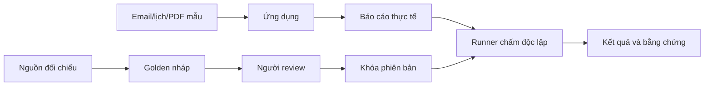

# Golden dataset và đánh giá

Golden là đáp án chuẩn do người review xác nhận, không phải email mẫu và không phải báo cáo do chính ứng dụng vừa tạo.



## Đặt ở đâu?

| Đường dẫn | Vai trò |
|---|---|
| `evals/cases/` | Sáu ca TC-01–TC-06: yêu cầu và đầu vào, không chứa đáp án |
| `evals/fixtures/manifest.json` | Đường tra manifest dữ liệu Google đã seed; chưa gắn ID từng ca |
| `evals/golden/` | Dữ kiện chuẩn, file nguồn đối chiếu và bản khóa; dữ liệu riêng tư được Git ignore |
| `evals/runner/` | Xuất kết quả thật, kiểm đúng ca và gọi scoring |
| `evals/scoring/` | Chấm nguồn/thời gian tự động, gắn review dữ kiện/checklist |
| `evals/results/` | Bản xuất, review và kết quả; Git ignore |

Golden và runner không được đưa vào Docker image ứng dụng. Runtime không import evals và không nhận golden trong prompt, tool hoặc API. Dữ liệu mẫu Google đã có; không chạy seed lại.

## Mỗi golden chứa gì?

Tên/domain đúng doanh nghiệp, mã ca/phiên bản, mốc thời gian và chế độ nguồn; danh sách dữ kiện bắt buộc có ID, mức quan trọng, file nguồn, hash và vị trí đối chiếu; checklist sẵn sàng; tên người review và trạng thái. Dữ kiện chưa có bằng chứng phải được bổ sung nguồn hoặc ghi yêu cầu xử lý thiếu dữ liệu trong checklist, không tự bịa đáp án.

Luồng là `draft → reviewed → locked`. CLI kiểm file nguồn tồn tại trong thư mục golden riêng tư, checksum và reviewer trước khi review/khóa. Khóa giúp phát hiện sửa ngoài ý muốn, không thay chữ ký/xác nhận người review. Khi nguồn hay đáp án thay đổi, tạo phiên bản mới và review lại.

Ví dụ từ root repo:

```sh
uv run --project apps/backend python -m evals.golden draft evals/golden/tc-01/v1.json --case TC-01 --company 'FPT Software' --domain fptsoftware.com --source-mode live
# Điền facts/checklist, lưu nguồn đối chiếu trong thư mục tc-01.
uv run --project apps/backend python -m evals.golden review evals/golden/tc-01/v1.json --reviewer 'Tên người review'
uv run --project apps/backend python -m evals.golden lock evals/golden/tc-01/v1.json
uv run --project apps/backend python -m evals.golden verify evals/golden/tc-01/v1.json
```

## Chấm thế nào?

Runner kiểm đúng ca, đầu vào, phiên bản và chế độ nguồn. Golden phải bao gồm các mục required_checks của ca trong checklist. Báo cáo export được hash; review phải gắn cả hash output lẫn hash golden. Review chứa `reviewer`, `output_sha256`, `golden_sha256`, `facts` (mỗi ID có verdict `correct_with_evidence` khi đúng và có bằng chứng), `readiness` (từng mục boolean), `distinct_sources_verified` và `news_freshness_passed`.

```sh
uv run --project apps/backend python -m evals.runner.run --case evals/cases/tc-01.json --golden evals/golden/tc-01/v1.json --api http://127.0.0.1:8000 --run-id RUN_ID --output evals/results/tc-01-output.json --result evals/results/tc-01-score.json
# Review bản output cố định, sau đó chấm lại file đó với --review.
uv run --project apps/backend python -m evals.runner.run --case evals/cases/tc-01.json --golden evals/golden/tc-01/v1.json --output evals/results/tc-01-output.json --review evals/results/tc-01-review.json --result evals/results/tc-01-score.json
```

Không có review hợp lệ: `eligible=false`, không báo phần trăm đầy đủ. Điều kiện đạt: ≥98% dữ kiện chuẩn, mọi dữ kiện quan trọng đúng/có bằng chứng, checklist đạt, ≥12 nguồn thực sự được trích dẫn và đã kiểm tính độc lập, không URL ngoài evidence, tin tức được review đạt mốc 30 ngày, thời gian trong ngưỡng config của lượt chạy. Đếm URL không chứng minh chất lượng hay nguồn độc lập. Review cần ghi nhận cả dữ kiện ngoài golden bị sai vào checklist chất lượng, tránh chỉ chấm phần hệ thống nhớ được.

**Hiện trạng:** Có schema/lock/runner và sáu case nháp; chưa có sáu golden đã review/khóa, chưa có kết quả nghiệm thu. Runner hỗ trợ lượt live; replay provider frozen chưa triển khai và bị từ chối khi chấm. Cần khóa nguồn frozen để so sánh hồi quy ổn định; lượt live dùng kiểm nguồn/tin mới. Thời gian hiện còn tính cả chờ xác nhận, chưa phải số đo tách thời gian chờ người.
