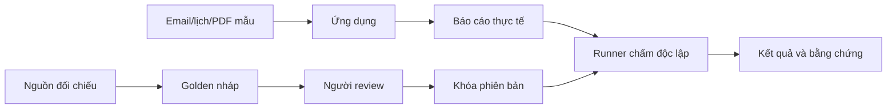

# Golden dataset và đánh giá

Golden là đáp án chuẩn do người review xác nhận, không phải email mẫu và không phải báo cáo do chính ứng dụng vừa tạo.



## Đặt ở đâu?

| Đường dẫn | Vai trò |
|---|---|
| `evals/cases/` | Sáu ca TC-01–TC-06: yêu cầu và đầu vào, không chứa đáp án |
| `evals/fixtures/manifest.json` | Đường tra manifest Google đã seed và file bindings riêng tư cho từng ca |
| `evals/golden/` | Dữ kiện chuẩn, file nguồn đối chiếu và bản khóa; dữ liệu riêng tư được Git ignore |
| `evals/runner/` | Xuất kết quả thật, kiểm đúng ca và gọi scoring |
| `evals/scoring/` | Chấm nguồn/thời gian tự động, gắn review dữ kiện/checklist |
| `evals/results/` | Bản xuất, review và kết quả; Git ignore |

Golden và runner không được đưa vào Docker image ứng dụng. Runtime không import evals và không nhận golden trong prompt, tool hoặc API. Email và lịch Google đã được chuẩn bị; không chạy seed lại.

Bindings local giữ bản nội dung nghiệp vụ của email, lịch và PDF, được Git ignore và không có trong bản clone mới. Bản gốc đọc từ Google cùng thông tin truy vết được lưu riêng tại `.runtime/provenance/`; bindings giữ ID nguồn để đối chiếu. Không dùng Message-ID gốc làm điều kiện duy nhất vì Gmail có thể ghi lại header này. Khi điều chỉnh nội dung nguồn đối chiếu, cập nhật checksum trong golden còn nháp; không coi bản đã biên tập là bản sao nguyên trạng từ Google. Checklist kiểm việc dẫn nguồn, không yêu cầu lặp lại nhãn bộ dữ liệu trong báo cáo.

## Mỗi golden chứa gì?

Tên/domain đúng doanh nghiệp, mã ca/phiên bản, mốc thời gian và chế độ nguồn; danh sách dữ kiện bắt buộc có ID, mức quan trọng, file nguồn, hash và vị trí đối chiếu; checklist sẵn sàng; tên người review và trạng thái. Dữ kiện chưa có bằng chứng phải được bổ sung nguồn hoặc ghi yêu cầu xử lý thiếu dữ liệu trong checklist, không tự bịa đáp án.

Luồng là `draft → reviewed → locked`. CLI kiểm file nguồn tồn tại trong thư mục golden riêng tư, checksum và reviewer trước khi review/khóa. Khóa giúp phát hiện sửa ngoài ý muốn, không thay chữ ký/xác nhận người review. Khi nguồn hay đáp án thay đổi, tạo phiên bản mới và review lại.

Ví dụ từ root repo:

```sh
uv run --project apps/backend python -m evals.golden draft evals/golden/tc-01/v1.json --case TC-01 --company 'FPT Software' --domain fptsoftware.com --source-mode live
# Điền facts/checklist, lưu nguồn đối chiếu trong thư mục tc-01.
uv run --project apps/backend python -m evals.golden review evals/golden/tc-01/v1.json --reviewer 'Tên người review'
uv run --project apps/backend python -m evals.golden lock evals/golden/tc-01/v1.json
uv run --project apps/backend python -m evals.golden verify evals/golden/tc-01/v1.json
```

## Chấm thế nào?

Trước khi golden được khóa, có thể thu báo cáo live để review bằng [collector](../evals/runner/collect.py). Lệnh sau tạo nghiên cứu và xác nhận đúng danh tính ca đã chọn; không duyệt báo cáo, gửi mail hoặc phát hành KB:

```sh
uv run --project apps/backend python -m evals.runner.collect --case evals/cases/tc-01.json --output-directory evals/results/firecrawl-live --confirm-identities
```

Lặp `--case` để chọn nhiều ca. Collector chạy tuần tự, lưu output riêng tư, checksum và trạng thái từng ca; manifest luôn ghi `human_review=pending`. Không đọc golden hoặc đưa đáp án vào ứng dụng. Đây là thu kết quả, chưa phải chấm nghiệm thu. Metadata đọc trang giúp review nguồn Firecrawl/fallback; đếm trang đọc được không chứng minh độ sâu hoặc nguồn độc lập. Ca cần PDF vẫn phải ghi thiếu đầu vào khi runtime chưa có ingestion, không đưa dữ kiện từ golden vào context để làm ca đạt.

Runner kiểm đúng ca, đầu vào, phiên bản và chế độ nguồn. Golden phải bao gồm các mục required_checks của ca trong checklist. Báo cáo export được hash; review phải gắn cả hash output lẫn hash golden. Review chứa `reviewer`, `output_sha256`, `golden_sha256`, `facts` (mỗi ID có verdict `correct_with_evidence` khi đúng và có bằng chứng), `readiness` (từng mục boolean), `distinct_sources_verified` và `news_freshness_passed`.

Scoring tự kiểm link Markdown và URL viết trực tiếp; số nguồn lấy từ report, còn URL ngoài evidence bị kiểm trong cả report và email. Evaluator không import implementation kiểm link của runtime. Không có human review hợp lệ thì các kiểm tra cấu trúc vẫn không tạo ra accuracy hoặc kết quả nghiệm thu.

```sh
uv run --project apps/backend python -m evals.runner.run --case evals/cases/tc-01.json --golden evals/golden/tc-01/v1.json --api http://127.0.0.1:8000 --run-id RUN_ID --output evals/results/tc-01-output.json --result evals/results/tc-01-score.json
# Review bản output cố định, sau đó chấm lại file đó với --review.
uv run --project apps/backend python -m evals.runner.run --case evals/cases/tc-01.json --golden evals/golden/tc-01/v1.json --output evals/results/tc-01-output.json --review evals/results/tc-01-review.json --result evals/results/tc-01-score.json
```

Không có review hợp lệ: `eligible=false`, không báo phần trăm đầy đủ. Điều kiện đạt: ≥98% dữ kiện chuẩn, mọi dữ kiện quan trọng đúng/có bằng chứng, checklist đạt, ≥12 nguồn thực sự được trích dẫn và đã kiểm tính độc lập, không URL ngoài evidence, tin tức được review đạt mốc 30 ngày, thời gian trong ngưỡng config của lượt chạy. Đếm URL không chứng minh chất lượng hay nguồn độc lập. Review cần ghi nhận cả dữ kiện ngoài golden bị sai vào checklist chất lượng, tránh chỉ chấm phần hệ thống nhớ được.

Khi review độ sâu nghiên cứu, kiểm thêm: sản phẩm được gọi tên và giải thích công dụng; ví dụ triển khai/đối tác có bằng chứng; số liệu đúng pháp nhân và thời điểm; tin mới có ý nghĩa với cuộc trao đổi; cơ hội được giải thích từ nhu cầu và nguồn công khai; câu hỏi cụ thể để xác nhận phần chưa biết. Nếu thiếu nguồn, đánh giá cách báo cáo nêu khoảng trống thay vì yêu cầu model tự điền. Bổ sung dữ kiện/checklist vào golden còn nháp sau khi đối chiếu nguồn; không dùng chính báo cáo sinh ra làm đáp án hoặc tự khóa golden.

Review email riêng với report: email phải viết cho khách/đối tác, chọn reply khi có email khách hoặc email mở đầu khi chưa có. Không chấp nhận bản tóm tắt nghiên cứu gửi nội bộ, lộ đánh giá/thông tin riêng, hoặc tự bịa năng lực người gửi và cam kết. Các ca prompt cũ chưa chứng minh tiêu chí email mới; cần chạy lại theo prompt 5 và review nội dung. Đồng bộ draft/reply thread trên Gmail chưa được triển khai.

**Hiện trạng:** Có schema/lock/runner, sáu ca và bộ golden nháp có dữ kiện nền, nguồn đối chiếu/checksum và checklist. Nguồn đối chiếu là ghi chú đã kiểm theo trang chính thức hoặc trích đoạn tìm kiếm, không phải bản lưu đầy đủ của website; nguồn bị chặn phải mở lại để người review kiểm tra trước khi khóa. Chưa có golden đã review/khóa hoặc kết quả nghiệm thu. Runner hỗ trợ lượt live; replay provider frozen chưa triển khai và bị từ chối khi chấm. Cần khóa nguồn frozen để so sánh hồi quy ổn định; lượt live dùng kiểm nguồn/tin mới. Thời gian hiện còn tính cả chờ xác nhận, chưa phải số đo tách thời gian chờ người.
