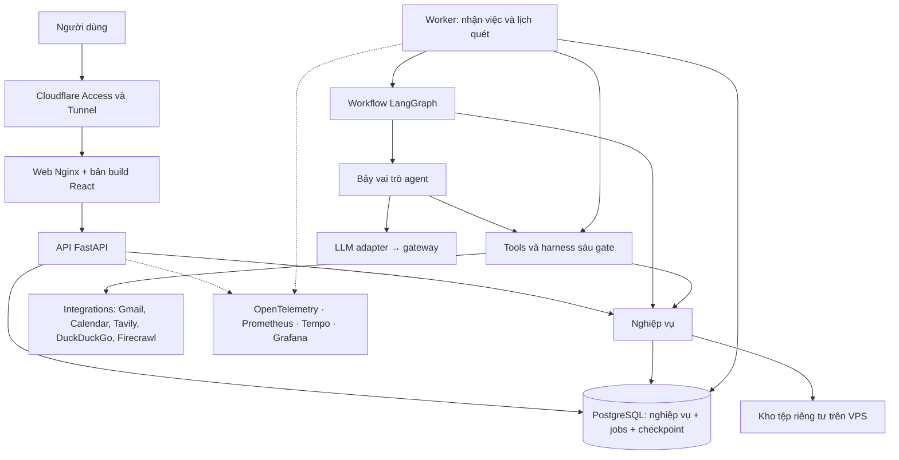
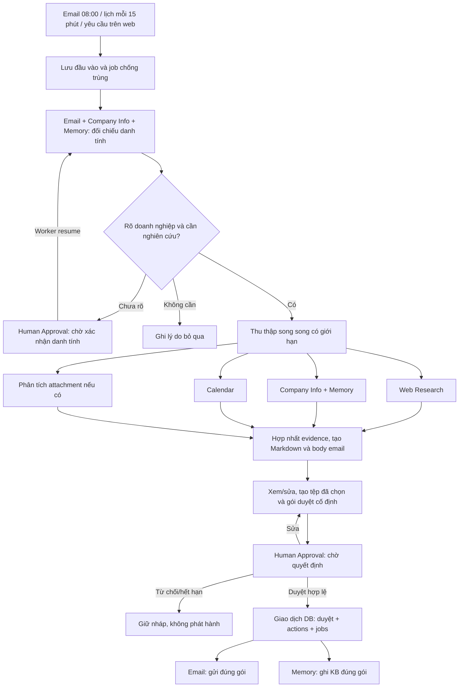

# Kiến trúc Email Assistant

**Trạng thái:** Kiến trúc đã được chủ sản phẩm chốt, dùng `domains/` cho nghiệp vụ. Đã dựng nền tảng local; các mục bên dưới mô tả kiến trúc đích, không đồng nghĩa mọi tính năng đã hoàn tất. Ứng dụng đã chạy trên VPS; xem [hướng dẫn vận hành](vps-release-guide.md). Trạng thái từng phần bên dưới không thay thế nghiệm thu toàn bộ PRD.

Ứng dụng phục vụ một người dùng, một hộp thư và một lịch: thu thập đầu vào, nghiên cứu doanh nghiệp, tạo báo cáo và chờ duyệt trước phát hành. [PRD](project-overview-pdr.md) sở hữu phạm vi; [quy tắc xử lý](technical-contracts.md) sở hữu dữ liệu/quyền/phục hồi; checklist setup riêng (xem danh mục tài liệu) sở hữu cấu hình và trạng thái tài nguyên thật. Báo cáo nghiên cứu local trong `plans/reports/` giải thích căn cứ và phương án đã loại.

## 1. Nhìn toàn bộ hệ thống

**Một repo, web có image riêng, một backend chia theo nghiệp vụ với hai tiến trình API và worker.** Bảy vai trò agent cùng chạy trong worker, không cần bảy server. React được Nginx phục vụ và proxy API cùng origin. Tách image cho phép cập nhật/rollback giao diện riêng; đổi lại phải giữ tương thích API và cấu hình routing. API và worker dùng chung image backend vì dùng cùng code/dependencies. Build thuộc [web Dockerfile](../apps/web/Dockerfile) và [backend Dockerfile](../apps/backend/Dockerfile); vận hành local qua [Makefile](../Makefile).



Model chạy qua gateway, không chạy trên VPS. Triển khai Docker Compose trên VPS 4 CPU/8 GB theo tài nguyên người dùng cung cấp; dung lượng sử dụng thực phải đo. Cloudflared chạy trên host theo cấu hình đã chuẩn bị, chuyển vào app loopback 8000 và Grafana loopback 3000; DB/telemetry backend chỉ ở mạng nội bộ. Connector và ứng dụng đã chạy; đường vận hành xem [hướng dẫn VPS](vps-release-guide.md). Không đọc lại secret để thiết kế.

## 2. Source code và trách nhiệm

```text
apps/
├── web/
│   ├── package.json và lockfile
│   └── src/
│       ├── app/                   Router, providers, bố cục
│       ├── features/              Màn hình theo nghiệp vụ
│       ├── components/            Thành phần giao diện dùng chung
│       └── lib/                   HTTP client, kiểu API sinh từ OpenAPI
└── backend/
    ├── pyproject.toml và uv.lock
    ├── migrations/                SQL có thứ tự và phiên bản
    ├── tests/                     Unit, integration và recovery
    └── src/email_agentic/
        ├── main.py                Khởi động API
        ├── worker.py              Khởi động worker
        ├── bootstrap.py           Khởi tạo và nối các thành phần
        ├── api/                   HTTP routes, auth, request/response
        ├── workflows/             Graph, node, state và điều kiện rẽ nhánh
        ├── agents/                Bảy vai trò, prompt, schema đầu ra
        ├── tools/                 Registry, harness, schema và handler
        ├── domains/               Quy tắc và dữ liệu theo nghiệp vụ
        ├── integrations/          Client Google, Tavily, DuckDuckGo, Firecrawl, LLM
        ├── runtime/               Jobs, lịch quét, lease, retry, resume
        └── platform/              Config, DB pool, tệp, auth, telemetry
infra/                             Compose, monitoring, cấu hình deploy
scripts/                           Setup, seed, backup và vận hành
config/                            Cấu hình hiện có, gồm cloudflared
```

Đây là ranh giới trách nhiệm, không yêu cầu tạo sẵn tất cả file/thư mục rỗng. Python dùng tên module hợp lệ theo quy ước ngôn ngữ. Các file setup đang có giữ nguyên đến bước di chuyển có kiểm chứng; không tồn tại song song hai backend hoặc hai bộ dependency làm nguồn chuẩn. Backend dùng uv, web dùng npm; chưa cần Turborepo hoặc package dùng chung khi mới có một web và một backend.

| Thành phần | Sở hữu | Không sở hữu |
| --- | --- | --- |
| `api` | Xác thực, kiểm request, gọi nghiệp vụ, trả dữ liệu | Không chạy nghiên cứu/gửi mail trong request |
| `workflows` | Thứ tự, song song, rẽ nhánh, chờ/resume | Không chứa SDK provider hoặc tự cấp quyền |
| `agents` | Vai trò, prompt, chọn ngữ cảnh, xử lý nội dung, kết quả có schema | Không dùng DB/provider client trực tiếp hoặc gọi agent khác để làm lead |
| `tools` | Thao tác có tên, input/output, quyền và harness | Không quyết định toàn bộ flow hoặc chứa prompt nghiệp vụ |
| `domains` | Quy tắc nghiệp vụ, giao dịch, repository và trạng thái | Không import agent, graph hoặc HTTP route |
| `integrations` | Gọi API/SDK, chuẩn hóa response và lỗi provider | Không quyết định duyệt hoặc ghi trạng thái nghiệp vụ |
| `runtime` | Nhận/giữ việc, deadline, retry, lịch và phục hồi | Không thay thế checkpoint hoặc bảng quyết định duyệt |
| `platform` | Kết nối DB, lưu tệp, config, auth, telemetry | Không trở thành nơi chứa logic nghiệp vụ dùng chung tùy ý |

Dependency được truyền từ `bootstrap.py`; không dùng import vòng. Nghiệp vụ giữ service/schema/repository gần nhau, SQL cụ thể với psycopg, không thêm một tầng repository tổng quát hoặc ORM thứ hai chỉ để bọc SQL. Kết nối DB/tệp là hạ tầng dùng chung, quyền sở hữu bảng vẫn thuộc domain. Công việc đọc/ghi Google hoặc tác động do agent yêu cầu phải qua tools; ghi trạng thái nội bộ của API/workflow đi qua service có kiểm quyền/giao dịch.

## 3. Bảy vai trò agent và tools nằm đâu?

| Vai trò trong `agents/` | Cách thực hiện | Tools được dùng theo vai trò |
| --- | --- | --- |
| Email | Code đọc dữ liệu; LLM trích nhu cầu/liên hệ và soạn body | Đọc email, lấy attachment; gửi là công cụ riêng chỉ runtime sau duyệt |
| Calendar | Code lấy lịch, đối chiếu thời điểm; LLM chỉ khi cần hiểu ngữ cảnh | Liệt kê/đọc cuộc họp; không có quyền sửa lịch |
| Company Info | Tra hồ sơ + bằng chứng pháp nhân/domain; LLM đề xuất đối chiếu | Tra doanh nghiệp; đọc nguồn xác minh; không tự chốt khi mơ hồ |
| Web Research | LLM tìm hướng nghiên cứu và trích dữ kiện; vòng lặp có giới hạn | Tìm web/tin, đọc trang, đọc tài liệu được cấp quyền |
| Memory | Code truy xuất ngữ cảnh, lưu dữ kiện có nhãn và provenance | Tra memory/KB, lưu memory nháp; ghi KB chỉ runtime sau duyệt |
| Report Generation | LLM tổng hợp nội dung; code kiểm nguồn và xuất định dạng | Lấy bằng chứng theo ID; render bản xem trước |
| Human Approval | Code tạo gói duyệt, dừng/chờ, kiểm quyết định | Yêu cầu xác nhận/duyệt và đọc quyết định; không tự duyệt |

Bảy vai trò không đồng nghĩa bảy LLM call hoặc bảy vòng ReAct. Mỗi vai trò có entrypoint và schema đầu vào/đầu ra rõ; chỉ phần cần hiểu/sinh nội dung mới gọi model. Prompt đặt cùng vai trò. Không dùng agent lead/supervisor tổng quát.

Mỗi agent nhận ngữ cảnh tối thiểu, tool allowlist và giới hạn do runtime cấp. Nó trả kết quả có cấu trúc: trạng thái, facts kèm evidence ID, thiếu/mâu thuẫn, usage và lỗi. Không dùng một transcript chung nạp toàn bộ email/web/lịch sử cho tất cả agent. Không trả hoặc lưu chain-of-thought.

`tools/` gồm registry, executor/harness và các nhóm email/calendar/company/research/memory/report/approval. Handler gọi service nội bộ hoặc adapter provider qua dependency được cấp. Tất cả lời gọi tool, cả từ code và model, qua đúng thứ tự:

**Validate Schema → Check Authentication → Check Scopes → Check Rate Limit → Audit Log → Execute Tool.**

Danh tính gồm chủ dữ liệu, actor/role, run ID và action ID khi có; runtime cấp chứ model không được sửa. Tool gửi chỉ nhận action ID rồi lấy gói đã duyệt từ DB; không nhận body/người nhận mới do model đưa sau duyệt. Tool ghi KB cũng gắn đúng gói và phiên bản. Các tool này không được đưa vào tập tool của LLM. Các cổng này vẫn phải chạy khi công cụ được gọi từ scheduler hoặc worker.

LLM adapter nằm trong `integrations/`, tách khỏi tool nghiệp vụ: nhận model từ env, endpoint/key do runtime giữ, chuẩn hóa structured output/tool calls/usage. Đề xuất dùng `langchain-openai` để nối gateway với LangGraph/LangChain; hiện chưa được thêm/cài/kiểm chứng trong app. Đặt chiến lược structured output rõ ràng và validate phía client; không dựa vào tự nhận diện provider từ tên model. Một model mặc định đủ ban đầu; không cần tên model trước để chốt source.

## 4. Nghiệp vụ và dữ liệu

| Nghiệp vụ trong `domains/` | Sở hữu dữ liệu/quy tắc |
| --- | --- |
| `inbox` | Email, cuộc họp, attachment nguồn, lịch sử đồng bộ |
| `companies` | Pháp nhân, domain, hồ sơ nội bộ và xác nhận danh tính |
| `research` | Tác vụ, branch result, nguồn, facts, mâu thuẫn và tiêu chí chất lượng |
| `reports` | Phiên bản Markdown, body email, manifest tệp xuất và hash |
| `approvals` | Gói phát hành cố định, người duyệt, thời hạn và quyết định |
| `publication` | Hành động gửi/lưu, chống trùng, kết quả và đối chiếu gửi |
| `knowledge` | Memory có nhãn nháp, KB đã duyệt, truy xuất và vòng đời |

Domain khác gọi service công khai của domain sở hữu; không tự sửa bảng của nhau. Khi duyệt, application service phối hợp approvals/publication/jobs trong một giao dịch DB. Đọc tổng quan có thể join qua query riêng; mọi sửa đổi vẫn qua owner. Không tạo event bus hoặc microservice cho việc này.

Một PostgreSQL chứa ba nhóm bảng tách biệt: nghiệp vụ, jobs/schedule, checkpoint LangGraph. Dùng `AsyncPostgresSaver` với run/thread ID ổn định, UUID ngắn. Bảng nghiệp vụ là nguồn chuẩn cho báo cáo, phê duyệt và kết quả gửi; checkpoint là vị trí chạy tiếp. Không dùng LangGraph Store như kho KB thứ hai.

Graph state chỉ giữ ID/phiên bản, kết quả nhánh cần điều phối và ngân sách; dữ liệu lớn/tệp nằm ở kho riêng. Nhánh song song ghi theo branch ID; không cùng ghi đè một trường state. Quy tắc hợp nhất/reducer loại trùng theo evidence ID thay vì nối danh sách mù khi chạy lại. DB write có khóa chống trùng; giao dịch DB và checkpoint không được giả định tự commit cùng nhau.

Memory/KB khởi đầu dùng bộ lọc company/context/status và tìm kiếm văn bản PostgreSQL. Kiểm chứng truy xuất tiếng Việt trên bộ mẫu, chưa thêm embedding/vector DB. Bằng chứng giữ nguồn/trang/đoạn/ngày; bản nháp cũ không trở thành fact chỉ vì đã lưu. KB giữ bản nội dung được duyệt, không phụ thuộc một tệp thô sẽ hết hạn.

## 5. Vòng đời tác vụ



Graph điều phối từ đầu vào đến nghiên cứu và chờ quyết định; nó không gọi Gmail send trong node có thể replay. Sau duyệt, publication worker xử lý danh sách hành động độc lập trong cùng hệ thống. Graph có thể resume để phản ánh quyết định/kết thúc, nhưng việc gửi/lưu không phụ thuộc một boolean nằm trong checkpoint.

Xác nhận danh tính và duyệt phát hành là hai quyết định khác nhau. `interrupt()` giải phóng lượt xử lý, không giữ một coroutine/process bận suốt 24 giờ. API ghi quyết định và resume job; chỉ worker gọi graph với cùng thread ID. Mỗi thread chỉ có một lượt thực thi đang giữ lease. Node tạo yêu cầu dùng khóa cố định; replay không tạo đề nghị mới hoặc kéo dài hạn duyệt.

Khi có Markdown và body, web cho xem nháp. PDF/Word đã chọn được tạo trước khi gói sẵn sàng duyệt; hash và bytes được giữ cố định. Sửa report/body/To/Cc/Bcc/tệp/lựa chọn phát hành tạo phiên bản mới và làm gói cũ không còn hợp lệ. API kiểm phiên bản lạc hậu và trả xung đột, không ghi đè âm thầm. Sau duyệt không gọi model viết lại.

Giao dịch duyệt khóa/kiểm đúng gói hiện hành, chủ báo cáo và hạn pending 24 giờ; ghi quyết định, từng action, job phát hành và job cập nhật graph cùng commit. Job xuất hiện sau commit; lỗi enqueue không làm mất hành động đã duyệt. Worker kiểm lại gói và atomically đánh dấu bắt đầu action. Nếu gói bị thay trước khi bắt đầu, action bị chặn. Khi đã bắt đầu gửi, UI phải thể hiện không thể hứa hủy/thu hồi; lưu kết quả thật dù người dùng tạo bản mới.

Email và KB có trạng thái riêng; KB lỗi không làm gửi lại email. Nếu worker chết hoặc timeout sau khi có thể đã gửi, action chuyển `unknown` để đối chiếu Sent bằng mã tương quan/MIME Message-ID và provider ID khi có. Các mã này giúp tìm lại, không phải bảo đảm Gmail deduplicate. Chưa rõ thì chờ xử lý, không retry mù.

## 6. Jobs, lịch và giới hạn thực thi

Dùng bảng jobs PostgreSQL làm hàng đợi bền vững. Worker nhận hàng bằng giao dịch ngắn với `FOR UPDATE SKIP LOCKED`, ghi lease/claim token rồi commit trước gọi mạng. Heartbeat gia hạn; ghi kết quả phải còn đúng token. Không giữ transaction hoặc row lock qua thời gian gọi model, chờ người hoặc gọi Google. Lease không thể ngăn một yêu cầu Gmail đã rời máy, vì vậy vẫn cần trạng thái `unknown` và đối chiếu.

Jobs chứa loại việc, owner, dedupe key, run/action ID, thời điểm có thể chạy, số lần thử, lease và lỗi đã làm sạch; không nhét toàn bộ nội dung email/prompt vào job. Runtime xử lý scan, nghiên cứu/resume, export, publication, cleanup và kiểm tra kết nối đã được yêu cầu. Không dùng FastAPI BackgroundTasks làm hàng đợi nghiệp vụ.

Một worker process chứa scheduler nhẹ và bộ xử lý jobs; lịch đến hạn được ghi DB với khóa theo khoảng chạy để restart không nhân đôi lịch. Email 08:00 và Calendar 15 phút theo Asia/Bangkok; downtime có đọc bù và quét trạng thái hiện tại. Không khởi scheduler trong API hoặc mỗi Uvicorn worker.

Khởi đầu một nghiên cứu hoạt động, tối đa bốn lời gọi thu thập độc lập đồng thời; provider limiter dùng chung cả vòng lặp của agent. Tác vụ chờ người không chiếm suất. Scan/duyệt/phát hành vẫn được phục vụ khi nghiên cứu đang chờ I/O. Parse PDF và export chạy trong subprocess có giới hạn bộ nhớ/thời gian, không chặn event loop.

Một nơi trong runtime kiểm soát retry: tối đa ba lần thử tổng cộng cho một thao tác lỗi tạm thời, trong ngân sách còn lại; SDK/HTTP/node không được tự nhân thêm retry. Worker crash vẫn tính lượt đã bắt đầu; tiếp tục có kiểm chứng, không đặt lại bộ đếm. Lỗi auth/input không retry; Gmail gửi mơ hồ đi đối chiếu riêng. Run giữ config snapshot, model ID, phiên bản prompt/workflow và giới hạn để điều tra kết quả.

Mục tiêu tạo Markdown mặc định 42 giây, cấu hình được và gồm chờ queue/retry; lưu ngưỡng theo run. Deadline xử lý hữu hạn khác mục tiêu này. Tách thời gian chờ người, thời gian xuất tệp và gửi sau duyệt thành phép đo riêng; run chờ xác nhận phải báo rõ, không âm thầm trừ để tuyên bố đạt mốc. Hết ngân sách thì tổng hợp phần có căn cứ nếu làm được và báo mục chưa đạt. Không cam kết 42 giây/12 nguồn khi chưa đo thực tế.

Gmail dùng history ID, xử lý mất history bằng full resync có phân trang/chống trùng; chỉ tiến cursor sau khi đã lưu đầu vào/jobs. Calendar bản đầu đọc đầy đủ cửa sổ 7 ngày mỗi lượt, có phân trang và recurring instances; so sánh phiên bản/cancellation với bản đã lưu. Không ghép syncToken với cửa sổ timeMin/timeMax dịch chuyển. Khi cần incremental sync sau này phải có thiết kế cache/token riêng. Không gộp tác vụ chỉ vì cùng company ID.

## 7. Báo cáo, tệp và giao diện

React + TypeScript + Vite, React Router và TanStack Query. Các feature gồm tổng quan, email/cuộc họp, nghiên cứu/nguồn, báo cáo/duyệt, doanh nghiệp/tri thức, kết nối/demo. Route feature và API nhóm theo nghiệp vụ; không chia màn hình theo từng agent. Web hiển thị branch status, tiến độ, lỗi và kết quả tiêu chí, không hiển thị suy luận nội bộ model.

HTTP API phiên bản `/api/v1`, schema Pydantic/OpenAPI làm hợp đồng chuẩn; web sinh kiểu/client từ OpenAPI để tránh chép tay Python sang TypeScript. Tạo job trả `202` và ID/link trạng thái; polling chỉ khi cần, dừng hoặc chậm lại theo trạng thái/tab. Mutation nhạy cảm không tự retry nếu chưa có khóa chống trùng. Chưa cần WebSocket/SSE cho phạm vi này.

Báo cáo có Markdown và nguồn; body email là tóm tắt ngắn nhưng giữ cảnh báo nghiệp vụ. Renderer dùng cùng phiên bản nội dung để tạo HTML xem trước, PDF và DOCX. Đề xuất WeasyPrint với template/CSS/font kiểm soát cho PDF, python-docx cho Word; cần kiểm chứng tiếng Việt, bảng, citation và dependency native trong image. Không coi mọi định dạng giữ layout giống hệt nhau.

PDF đầu vào trích text theo trang bằng pypdf rồi phân tích với LLM, giữ page provenance. Tệp scan, mã hóa hoặc lỗi trích xuất phải được phát hiện và hiện phần chưa phân tích; không gọi text extractor là OCR hoặc giả vờ đọc được nội dung. OCR/vision bổ sung chỉ khi case yêu cầu, không mặc định thêm một agent/server.

Kho tệp là volume riêng tư, tên do ứng dụng sinh, metadata/hash trong DB. Ghi tệp tạm rồi atomic rename, sau đó ghi manifest DB; có kiểm tra/dọn orphan, không giả định DB và filesystem là một transaction. API kiểm owner khi tải/xem tệp; không public toàn bộ volume. Chỉ dữ liệu cần thiết được đưa vào model, không gửi token hoặc đường dẫn secret.

## 8. Truy cập, quan sát và phục hồi

Cloudflare Access bảo vệ app/Grafana; connector và API kiểm JWT đúng chữ ký, issuer, audience và thời hạn. Backend map danh tính đã xác minh sang owner, kiểm quyền/phiên bản ở mọi mutation; Access không thay quyết định duyệt. Các request thay đổi dữ liệu có kiểm Origin/CSRF phù hợp cơ chế cookie. OAuth Google là kết nối hộp thư/lịch, khác đăng nhập vào web. Seed token không mount vào runtime.

Nguồn email/web/PDF là dữ liệu không đáng tin. Tool chỉ nhận tài nguyên được cấp quyền; URL fetch chặn mạng nội bộ/metadata, kiểm redirect/DNS và giới hạn response. Renderer không nhận HTML/CSS tùy ý, không tự tải tài nguyên mạng hoặc đường dẫn file từ nội dung model. Parse/export chạy với quyền hạn chế. Không cần agent bảo mật thứ tám.

OpenTelemetry nối trace API → job → graph → agent → model/tool; resume sau chờ dùng trace mới có liên kết run/trace trước thay vì giữ span mở 24 giờ. Prometheus cho chỉ số vận hành, Tempo cho trace, Grafana cho dashboard port riêng. Cost/usage theo từng run lưu trong DB để không lệ thuộc telemetry; giá chưa biết ghi chưa xác định. Metric không dùng run ID/email/URL làm label có quá nhiều giá trị. Audit quyết định nghiệp vụ khác trace quan sát và không bị sampling bỏ mất.

Giữ telemetry đã làm sạch 30 ngày; raw email/attachment/research 30 ngày, report/history 90 ngày, KB đến khi xóa/reset theo PRD. Tệp đính kèm gói duyệt là artifact của report, giữ theo vòng đời report; gói chờ và hành động chưa rõ phải được đối chiếu trước khi xóa phần cần phục hồi. Cleanup không xóa email Google. Cần đo RAM/đĩa với đủ stack và thời gian lưu; không tự giảm retention để vừa VPS.

Backup DB nhất quán cùng manifest/tệp tương ứng vào restic/R2 theo đường đã chuẩn bị. Backup trước thay đổi schema/data, kể cả baseline ban đầu; kiểm restore ở môi trường riêng. Migration SQL có thứ tự/checksum, chạy một lần ở bước release bằng quyền riêng; API/worker không tự migrate khi boot. Với quy mô này có thể dừng nhận việc, đợi job kết thúc/checkpoint và migration trong cửa sổ bảo trì. Giữ image cũ nhưng rollback phải kiểm cả tương thích schema.

## 9. Những gì đã quyết và cần kiểm chứng

Đã chọn: flow do code điều phối, apps/web + apps/backend, React/FastAPI, worker riêng, PostgreSQL, bảy vai trò và harness sáu gate. Ranh giới domains/jobs/phát hành đã được chốt cùng kiến trúc.

Không thêm supervisor, microservice, MCP/A2A, Redis/Celery, vector DB, broker hoặc kho KB thứ hai khi chưa có nhu cầu được chứng minh. Quy mô nhiều worker/tích hợp mới có thể thay đổi lựa chọn hàng đợi; không phải yêu cầu hiện tại.

Còn phải kiểm chứng khi triển khai: tương thích package/gateway, renderer/font/PDF, giới hạn tài nguyên, restart/resume, dual-write DB/checkpoint, cạnh tranh sửa/duyệt/gửi và đối chiếu Gmail. Tên model/credential đã có qua cấu hình, không cần hỏi lại. Bảng giá/hạn mức thực, ngân sách và lịch demo còn cần xác nhận; không cản việc chốt ranh giới kiến trúc.

## 10. Nền tảng hiện có và phần còn lại

Source đã có React, API/worker, migration có backup, queue PostgreSQL, checkpoint LangGraph, bảy vai trò và tool harness. Luồng tạo nghiên cứu thủ công → xác nhận domain → thu thập thật → nháp → sửa/duyệt → outbox email/KB đã được nối trong source. Đã đọc Google/Tavily thật; bước tạo báo cáo dài chưa qua kiểm chứng gateway (timeout hoặc response chưa đạt schema). Chưa xác nhận toàn bộ luồng thực chạy thành công. Compose có Prometheus, Tempo, Grafana; đã triển khai VPS qua Cloudflare Access.

Chưa coi là hoàn tất PRD: nhận diện/tự kích hoạt nghiên cứu từ email/lịch, Gmail history cursor, phân tích PDF, xuất PDF/Word và attachment bất biến, đối chiếu Sent trên UI, cleanup/retention. Backup định kỳ do [script và systemd timer](vps-release-guide.md#backup-và-rollback) sở hữu. Luồng web dùng năm chủ đề cố định qua Tavily và DuckDuckGo; cấu hình/giới hạn hiện tại xem [hướng dẫn ứng dụng](application-guide.md). Luôn yêu cầu xác nhận danh tính. Đo thời gian hiện gồm cả lúc chờ xác nhận nên chưa dùng để chứng minh mục tiêu 42 giây. Trace hiện ở API/job/tool, chưa nối đầy đủ ngữ cảnh xuyên tiến trình.

[Evals](evaluation-guide.md) nằm ngoài runtime: cases/fixture là đầu vào; golden riêng tư phải có người review và khóa trước chấm. Runner hiện hỗ trợ xuất/chấm lượt live; replay provider frozen còn phải triển khai. Không dùng kết quả live làm bằng chứng hồi quy frozen.
