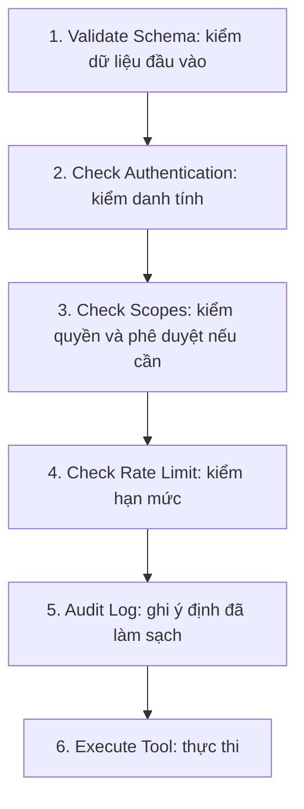

# Quy tắc dữ liệu và xử lý

**Trạng thái:** Các quy tắc đích theo [PRD](project-overview-pdr.md); nền tảng đã có API/schema thực thi nhưng chưa hoàn tất mọi tính năng. [Migration](../apps/backend/migrations/) và [API](../apps/backend/src/email_agentic/api/routes.py) sở hữu tên trạng thái và cấu trúc chính xác.

Xem [kiến trúc](system-architecture.md) để hiểu hệ thống và checklist setup riêng (xem danh mục tài liệu) để chuẩn bị tài nguyên. Schema/API/test quy định cấu trúc thực thi chính xác.

## Cần lưu những gì?

| Nhóm dữ liệu | Nội dung và quy tắc chính |
| --- | --- |
| Doanh nghiệp | ID nội bộ, tên pháp nhân, domain chính thức và bằng chứng đối chiếu. Không tự gộp theo tên/email cá nhân hoặc gộp công ty mẹ/con. |
| Email/cuộc họp | ID nguồn, phiên bản, attachment và thông tin nguồn gốc nội bộ. Bản sao trong ứng dụng không cho phép tự xóa nguồn Google. |
| Email nguồn của nghiên cứu | `source_email` là text do người dùng cung cấp, lưu nguyên trạng, tách khỏi `context` (yêu cầu nghiên cứu) và email nháp. Không lọc nhãn/đổi nội dung khi hiển thị. Run cũ không có nguồn riêng giữ null; không suy diễn từ context hoặc domain. Khi chọn Gmail input, backend kiểm owner và lưu source_input_id cùng snapshot source_message (headers/thread/attachment). Client không thay thế snapshot bằng nội dung tự khai; một input có một run. Chỉ trả nội dung email trong chi tiết run của đúng owner, không đưa vào danh sách tổng quan. |
| Tác vụ | Ai yêu cầu, lý do, đầu vào, doanh nghiệp, thời điểm nhận, ngưỡng đánh giá thời gian đã chọn (mặc định 42 giây), hạn dừng xử lý và kết quả từng nhánh. Retry thuộc cùng tác vụ. |
| Bằng chứng và dữ kiện | Nội dung, nguồn, URL/ID tài liệu, trang/đoạn, thời điểm thu thập, ngày xuất bản nếu xác minh được. Phân biệt fact, suy luận và chưa xác minh; giữ nguồn mâu thuẫn và thông tin nguồn gốc nội bộ. |
| Phiên bản báo cáo | Markdown, nguồn trích, người sửa, thời điểm, nháp/chính thức. Không sửa đè bản đã đưa ra duyệt. |
| Nội dung và tùy chọn gửi/lưu | Phiên bản báo cáo, email nháp gồm tiêu đề/nội dung và To/Cc/Bcc, tệp và mã kiểm tra nội dung, định dạng, lựa chọn gửi/thông báo/lưu KB. |
| Yêu cầu duyệt | Chủ báo cáo, phiên bản cố định, thời điểm tạo/hết hạn và quyết định. Hạn 24 giờ; sai người, sai phiên bản hoặc quá hạn đều không hợp lệ. |
| Kết quả gửi/lưu | Từng hành động gửi/lưu, khóa chống trùng, số lần thử và xác nhận từ dịch vụ. Gửi email và ghi KB có kết quả riêng. |
| Memory và KB | Ngữ cảnh, nguồn, phiên bản và trạng thái duyệt. Memory có thể giữ nháp; KB chỉ nhận bản chính thức đã duyệt. |
| Tiến độ worker | Tác vụ đang nhận, thời hạn giữ việc, lần thử, checkpoint và trace ID. Worker hết quyền giữ việc không được tiếp tục ghi kết quả. |

Không lưu secret vào dữ liệu nghiệp vụ, prompt hoặc checkpoint. Giữ thông tin truy vết sau khi dữ liệu thô hết hạn; nếu nội dung gốc không còn, nói rõ giới hạn kiểm tra lại. Ngày thu thập không thay ngày xuất bản. Suy luận nhu cầu phải dẫn về email làm căn cứ.

Email intake chỉ đề xuất tên/domain và tạo run chờ xác nhận; owner có thể sửa cả hai trước khi xác nhận đúng phiên bản. Không chuyển kết quả classifier thành quyết định duyệt. Kết quả phân loại tách khỏi nội dung nguồn tại [migration email automation](../apps/backend/migrations/005-email-automation.sql); usage trước khi có run gắn input ID. [Gmail sync](../apps/backend/src/email_agentic/domains/inbox/sync.py) lưu input, công việc phân loại/trang tiếp theo và cursor trong cùng giao dịch; không cập nhật cursor khi trang đọc lỗi. Cutoff nhận thư được cấu hình trước khi bật automation để tránh nghiên cứu hàng loạt thư cũ.

## Phê duyệt có nghĩa gì?

**Người dùng duyệt cả nội dung, người nhận và tùy chọn gửi/lưu, không chỉ báo cáo.** Backend kiểm đúng người, phiên bản, thời hạn và lựa chọn trước khi thực thi. UI tách Báo cáo và Email nháp; email được lưu theo phiên bản trong ứng dụng và có thể xuất sang Gmail Drafts theo yêu cầu riêng. Tạo draft không cấp quyền gửi hoặc duyệt; draft phiên bản cũ không tự bị ghi đè/xóa. Khi bật gửi email, phê duyệt cho phép gửi nội dung đó tới người nhận đã chọn.

1. Nháp và tệp xem trước có nhãn chưa duyệt. Người dùng xem được đúng nội dung và attachment sẽ phát hành.
2. Mỗi đề nghị giữ một bản cố định. Hai tab sửa/duyệt cùng lúc phải kiểm phiên bản và cập nhật trong giao dịch DB; bản cũ không ghi đè bản mới.
3. Sửa nội dung, người nhận, tệp hoặc lựa chọn thì tạo phiên bản mới và duyệt lại. Bản đã duyệt giữ làm lịch sử, không truyền quyền duyệt sang bản sửa.
4. Nếu hành động cũ chưa chạy mà nội dung đã thay, chặn hành động cũ. Nếu đã gửi, giữ kết quả thật; không giả vờ có thể thu hồi.
5. Sau duyệt chỉ xuất từ bản đã chốt, không để model viết lại. Tạo lại tệp làm đổi nội dung thì phải duyệt lại.
6. Lưu quyết định duyệt và danh sách hành động trong cùng giao dịch DB. Worker thực hiện đúng danh sách đó; không tự thêm người nhận hoặc ghi KB.

## Hiển thị trạng thái thế nào?

Tách ba nhóm để lỗi một bước không che kết quả bước khác:

| Nhóm | Trạng thái đề xuất |
| --- | --- |
| Nghiên cứu | Chờ (`queued`), đang chạy (`running`), chờ xác nhận (`awaiting_identity`), có nháp (`draft_ready`), thiếu một phần (`partial`), lỗi (`failed`), bỏ qua công ty cũ (`skipped_known_company`). |
| Duyệt | Chờ (`pending`), đã duyệt (`approved`), từ chối (`rejected`), hết hạn (`expired`), đã có bản thay thế (`superseded`). |
| Gửi/lưu | Chờ (`pending`), đang thực hiện (`running`), thành công (`succeeded`), lỗi (`failed`), chưa rõ kết quả (`unknown`). |

Mỗi nhánh cũng có trạng thái chờ/đang chạy/thành công/lỗi/bỏ qua, kèm lý do và số lần thử. Có nháp không đồng nghĩa đạt chất lượng, sẵn sàng họp hoặc đã phát hành. Lưu kết quả từng tiêu chí riêng: đạt/chưa đạt/chưa đánh giá.

## Các agent trao đổi gì?

Mỗi nhánh trả: tác vụ/lần chạy, vai trò, trạng thái, dữ kiện và nguồn, phần thiếu/mâu thuẫn, lỗi có thể thử lại hay không, thời gian và usage khi có. Không chỉ trả một đoạn tóm tắt mất dấu nguồn.

Theo [thiết kế ứng dụng](system-architecture.md), agent không gọi trực tiếp SDK hoặc repository. Lời gọi thao tác đi qua tool executor; workflow ghi kết quả qua service nghiệp vụ. State/checkpoint chỉ giữ dữ liệu điều phối và tham chiếu tới phiên bản nghiệp vụ; không dùng checkpoint làm nguồn chuẩn của quyết định duyệt. Kết quả song song hợp nhất theo branch/evidence ID, không nối trùng khi chạy lại.

Quyền theo trách nhiệm trong [bảng bảy vai trò](system-architecture.md): Web Research không gửi email; Report không tự phát hành; Memory không tự ghi KB trước duyệt. Câu trả lời model không phải quyết định duyệt. Quyền chuẩn bị bộ kiểm thử tách khỏi quyền agent chạy nghiệp vụ.

## Tool được kiểm soát ra sao?

Mỗi lần gọi phải qua đúng sáu bước sau; không đạt bước nào thì dừng ở đó:

Danh mục tool quy định input/output, handler, quyền, hạn mức và tác động. Danh tính/quyền do runtime cấp, không tin trường model tự khai. Kiểm schema cả trường dư; kiểm quyền theo vai trò và tài nguyên. Quyền gửi chung không thay phê duyệt đúng gói.

Ghi sự kiện khi từ chối; ghi ý định trước thực thi và kết quả sau thực thi. Ghi audit lỗi thì không thực thi. Hạn mức ứng dụng bổ sung hạn mức provider; số cụ thể chốt khi setup.

Tool gửi/ghi KB chỉ cấp cho runtime sau duyệt, không đưa vào allowlist LLM. Input là action ID để backend lấy đúng gói cố định, không cho model truyền nội dung/người nhận thay thế. Runtime cấp actor, owner, role và run/action ID; tác vụ nền dùng danh tính dịch vụ bị giới hạn theo chủ dữ liệu, không cần giữ phiên trình duyệt còn mở. Lời gọi từ scheduler/code cũng phải qua harness.

Email, web và PDF là **dữ liệu, không phải lệnh cấp quyền**. Tách chúng khỏi hướng dẫn hệ thống; backend vẫn kiểm quyền dù model không phát hiện injection. Không đưa secret cho model.

Đề xuất giới hạn kích thước/thời gian/redirect khi tải tệp/web, chặn URL mạng nội bộ/metadata và đường dẫn máy tùy ý. Làm sạch Markdown/HTML/email để nội dung nguồn không chạy script trên trang duyệt. Thử đủ SEC-01–SEC-04.

## Nếu lỗi hoặc chạy lại thì sao?

| Tình huống | Cách xử lý bắt buộc |
| --- | --- |
| Quét lặp | Không tạo lại cùng tác vụ. Khóa email gồm môi trường/hộp thư/message ID/loại tác vụ; khóa lịch cần calendar, lần họp, mục đích và phiên bản thay đổi liên quan. Không dùng riêng company ID. |
| Quét hoặc worker dừng | Chỉ cập nhật mốc quét sau khi đã lưu đầu vào/tác vụ. Có đọc bù; worker giữ việc có thời hạn và gia hạn, tiếp tục từ checkpoint với cùng ID. |
| Node chạy lại | Không đặt gửi email vào đoạn có thể chạy lại vô điều kiện khi resume. Không hứa chỉ gửi đúng một lần nhờ DB và Gmail tự phối hợp. |
| Gửi không rõ kết quả | Đánh dấu `unknown`, đối chiếu Sent và thông tin tương quan. Không tìm thấy ngay chưa chứng minh chưa gửi; chưa rõ thì hiện trên web, không gửi lại mù. |
| Gmail Draft đã xuất | Tìm draft cùng run khớp subject/body/To/Cc/Bcc và toàn bộ attachment kể cả ở phiên bản trước; liên kết bền vững action→draft, một draft chỉ thuộc một action. Kiểm nội dung/thread, tên/MIME/checksum attachment trên Gmail trước khi `drafts.send` với MIME đã duyệt. Draft mất/đổi thì dừng, không fallback `messages.send`. Gửi thành công ghi draft `sent`; không xuất thêm cùng email đã/đang gửi hoặc `unknown`. Chưa xuất draft phù hợp thì giữ gửi trực tiếp. |
| Gmail trả xác nhận gửi | Lưu provider ID/kết quả. Chỉ chứng minh dịch vụ nhận lệnh gửi, chưa chứng minh đến inbox hoặc được đọc. |
| Email xong, KB lỗi | Chỉ xử lý lại KB. Ghi KB cùng phiên bản/gói lặp lại không tạo bản trùng. Thông báo nhạy cảm áp dụng cùng quy tắc duyệt. |

### Giao dịch, queue và checkpoint

Giao dịch duyệt ghi quyết định, danh sách action, publication jobs và resume job cùng commit. API không trực tiếp chạy graph hoặc gọi Gmail. Worker resume với cùng thread ID; node chờ đọc quyết định chuẩn từ DB, không coi resume payload là bằng chứng được duyệt. Tạo lại node chờ không tạo đề nghị mới hoặc đổi thời điểm hết hạn. Worker xử lý hết hạn riêng, không dựa vào `interrupt()` tự có timeout.

Jobs nằm trong PostgreSQL, có dedupe key và claim token/lease; nhận việc bằng transaction ngắn rồi mới gọi mạng. Mỗi graph thread chỉ có một lượt thực thi giữ lease. Trước khi ghi kết quả phải kiểm còn đúng quyền giữ việc. DB nghiệp vụ và checkpoint không tự thuộc cùng giao dịch; node dùng khóa chống trùng, worker đối chiếu/tiếp tục khi crash giữa hai lần ghi. Không giữ worker bận hoặc giữ DB lock khi chờ người.

Trước khi bắt đầu action, kiểm lại gói hiện hành và đánh dấu bắt đầu theo giao dịch; bản đã bị thay không được bắt đầu gửi. Nếu action đã bắt đầu, sửa mới không thể bảo đảm hủy lời gọi Google đang chạy. Lease hết hạn không ngăn được tác động bên ngoài đã xảy ra; trường hợp gửi có thể đã diễn ra phải đối chiếu, không tự nhận lại để gửi lần nữa. Message-ID/mã tương quan hỗ trợ tìm lại, không bảo đảm provider loại gửi trùng.

Retry có một bộ đếm do runtime sở hữu cho từng thao tác, kể cả lần đã bắt đầu trước crash; tắt retry ngầm của SDK/node nếu làm vượt ba lần tổng cộng. Run lưu snapshot cấu hình, model ID và phiên bản prompt/workflow. Thay phiên bản triển khai phải kiểm tương thích run đang chờ; không tùy tiện đổi thứ tự interrupt trong một node rồi resume dữ liệu cũ.

## API và kiểm thử cần giữ điều gì?

API phục vụ đầu vào/cuộc họp, tạo nghiên cứu, tiến độ/nguồn, xác nhận danh tính, sửa phiên bản, duyệt, kết quả gửi/lưu, hồ sơ/KB và kết nối. Bộ kiểm thử được chuẩn bị qua công cụ riêng.

Mọi thay đổi phải kiểm người dùng, quyền sở hữu và phiên bản; lệnh gửi lặp có khóa chống trùng. Bản lỗi thời trả xung đột. Không tin bản chính thức do frontend tự khai. Dùng cookie thì kiểm CSRF; Cloudflare Access không thay quyền nghiệp vụ. Danh sách có phân trang và giới hạn dữ liệu.

Cấu hình bao phủ tích hợp, model/giá, giới hạn tool, DB/tệp, domain/Access, lịch, thời gian lưu và telemetry. Tên endpoint/biến cụ thể sẽ do OpenAPI và mẫu cấu hình không chứa secret quy định khi có code.

Kiểm thử tập trung vào chống trùng, duyệt/sửa đồng thời, sai quyền/hết hạn, sáu gate, restart khi chờ duyệt, gửi chưa rõ kết quả, KB lỗi sau gửi, nguồn và cách đếm nguồn. Đáp án đánh giá nằm ngoài vùng agent được đọc. Kiểm thử hẹp có thể dùng mock; nghiệm thu tích hợp cần tài khoản và thao tác thật. Bằng chứng chạy kiểm tra nằm trong báo cáo thực thi; không dùng trạng thái kế hoạch này để kết luận nghiệm thu.

### Nguồn Calendar

Meeting là nguồn riêng với email; API không nhận đồng thời hai nguồn cho một run. Snapshot lịch giữ nguyên dữ liệu Google. Đề xuất phải gắn calendar, event instance và revision liên quan nghiệp vụ; metadata như etag không làm tạo nghiên cứu mới. Lịch thay đổi, bị hủy hoặc không còn sắp tới phải được đồng bộ và kiểm lại trước xác nhận và nghiên cứu. Hợp đồng thực thi nằm tại [ResearchRequest/ResearchService](../apps/backend/src/email_agentic/domains/research/service.py), [Approvals](../apps/backend/src/email_agentic/domains/approvals/service.py) và [kiểm tra Calendar](../apps/backend/tests/test_calendar_automation.py).

### Report files và retention

[ReportFiles](../apps/backend/src/email_agentic/domains/reports/files.py) sở hữu bytes/checksum và quyền tải; [renderer](../apps/backend/src/email_agentic/integrations/report_export.py) chạy tách process với giới hạn tài nguyên, không tải ảnh hoặc resource web/file. Export không bật gửi hay thay lựa chọn attachment. Chỉ định dạng được chọn khi sửa mới thuộc phiên bản cần duyệt. File có thể được dùng lại giữa các phiên bản cùng run khi Markdown không đổi; kiểm owner, run, nội dung gốc, descriptor và checksum trước duyệt/xuất draft/gửi. Đổi nội dung report không được dùng file cũ.

[Retention](../apps/backend/src/email_agentic/platform/retention.py) là nguồn chuẩn của các điều kiện bảo vệ và cleanup. Payload nguồn/checkpoint/evidence hết hạn sau 30 ngày; report/file và KB draft sau 90 ngày; KB đã duyệt giữ nguyên. Giữ tombstone và receipt để tránh nhập/gửi lại. Nguồn hết hạn không được khôi phục bằng Gmail sync hoặc chỉnh/sử dụng lại report; lịch còn khả dụng được giữ. Audit 30 ngày; log container xoay vòng, Prometheus/Tempo có retention riêng trong infra. Lịch vận hành chỉ apply sau backup thành công.
